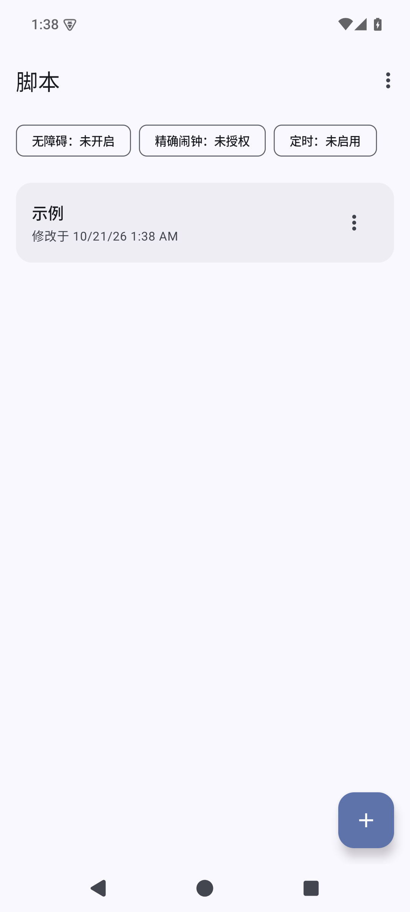

# MicroAuto

[](https://github.com/backtraxe/microauto/actions/workflows/android.yml)

一个非 root、纯本机运行的 Android 界面自动化工具。用 JavaScript 写脚本，通过无障碍服务查找控件、点击、滑动和启动应用，适合自动签到这类固定流程。

完整教程见 [docs/tutorial.md](docs/tutorial.md)，包含安装、权限、脚本 API、自动签到实战和常见问题。

## 已实现的最小功能

- 无障碍查找与操作：`text` / `textContains` / `textMatches` / `id` / `desc` / `className`
- 控件操作：`findOne`、`exists`、`click`、`longClick`、`setText`、`scrollForward`
- 坐标操作：`click(x, y)`、`longClick(x, y)`、`swipe(...)`、`press(...)`
- 应用与系统：`launchApp`、`currentPackage`、`waitForPackage`、`back`、`home`、`recents`
- 脚本工具：`sleep`、`toast`、`log`、`exit`、`dump`
- 多脚本文件管理：新建、导入、重命名、删除，每个脚本独立文件
- 每个脚本独立编辑，支持保存、运行、停止和日志
- 每天固定时间定时执行（同一时间绑定一个脚本，精确闹钟不可用时自动降级）
- 前台服务运行、开机恢复定时
- Material 3 界面：动态取色、edge-to-edge、脚本卡片、状态 chips、FAB、定时底部 sheet

## 构建

需要 JDK 17 和 Android SDK（platform 35、build-tools 35.0.0）。

```bash
./gradlew :app:testDebugUnitTest
./gradlew :app:assembleDebug
```

APK 输出：`app/build/outputs/apk/debug/MicroAuto-<版本号>.apk`，例如 `MicroAuto-0.3.1.apk`。

## 测试

JVM 单元测试（37 个）：

```bash
./gradlew :app:testDebugUnitTest
```

仪器化测试（13 个，需要模拟器或真机）：

```bash
./gradlew :app:connectedDebugAndroidTest
```

macOS Apple Silicon 本地一键模拟器测试（安装 API 35 arm64 镜像、创建 AVD、启动、跑测试）：

```bash
export ANDROID_HOME=/opt/homebrew/share/android-commandlinetools
./scripts/run-emulator-tests.sh
```

## 界面预览



截图：[首页](docs/screenshots/home.png) · [编辑页](docs/screenshots/editor.png) · [定时](docs/screenshots/schedule.png) · [运行日志](docs/screenshots/run-log.png)

## CI/CD

GitHub Actions 配置在 `.github/workflows/android.yml`：

- push 到 `main` 或提 PR：自动运行单元测试、Android Lint、构建 debug APK，并在 API 35 模拟器上运行仪器化测试；APK 作为 Actions artifact 上传。
- push `v*` 标签：`build` 和 `ui-test` 都通过后自动创建 GitHub Release，并附带 `MicroAuto-<版本号>.apk`。

发布一个版本：

```bash
git tag v0.3.1
git push origin v0.3.1
```

当前 Release 附件是 debug 签名 APK，可直接安装；如果需要正式签名，需要在仓库 Secrets 中配置 keystore 并补充 signingConfig。

## 使用

1. 安装 APK，打开 MicroAuto。
2. 点顶部「无障碍」状态 chip（或右上角菜单 → 无障碍设置），在系统设置中开启「MicroAuto 自动化服务」。Android 13+ 侧载应用如果开关是灰的，先到应用信息里允许「受限设置」。
3. 点右上角菜单 →「省电设置」，把 MicroAuto 设为不受电池优化限制；并在系统设置里允许自启动（国产 ROM）。
4. 点「精确闹钟」状态 chip（或右上角菜单 →「精确闹钟」）授予权限（Android 12+），否则定时可能被系统延后。
5. 点右下角「+」新建脚本，或点右上角菜单 →「导入脚本」从文件选择器导入 `.js` / `.txt` 文件。
6. 点脚本卡片进入编辑页，保存后运行。
7. 需要定时签到：在编辑页点「设置」，选择时间并启用，保存定时。

建议使用一台插电、常亮的旧手机，并在开发者选项中开启「充电时不锁定屏幕」。锁屏状态下无法执行 UI 操作。

## 脚本管理

- 首页列表按修改时间排序。
- 新建：创建一个「新脚本」并进入编辑页。
- 导入：从系统文件选择器导入文本脚本；同名会自动追加 `(2)`。
- 导出：列表行右侧「⋮」→「导出」，保存为 `.js` 文件。
- 重命名：列表行右侧「⋮」→「重命名」。
- 删除：列表行右侧「⋮」→「删除」；如果删的是当前定时脚本，会同时取消定时。
- 每个脚本保存为应用内部独立文件。
- 定时任务同一时间只绑定一个脚本；在某个脚本里保存定时会接管全局定时。

## 脚本示例

```js
launchApp("com.example.app");
waitForPackage("com.example.app", 10000);
sleep(3000);

if (text("跳过").exists()) {
  text("跳过").findOne(2000).click();
}

var entry = textMatches(/签到|每日签到/).findOne(5000);
if (entry) {
  entry.click();
  var button = textMatches(/立即签到|签到/).findOne(5000);
  if (button) button.click();
  toast("签到完成");
} else {
  toast("未找到签到入口");
}
```

调试时在编辑页点「看界面」，它会在 5 秒后 dump，给你时间切到目标界面。等价脚本：

```js
toast("5 秒内切到目标界面");
sleep(5000);
dump();
```

日志里会输出当前界面的节点树，包含 `text`、`id`、`desc`、`bounds`，用来编写选择器。

## API 约定

- `findOne(timeout)` 默认等待 10 秒，超时返回 `null`；与 Auto.js 的无限等待不同。
- 选择器链式调用组合多个条件，条件之间是 AND。
- 单击优先使用无障碍 `ACTION_CLICK`，失败后向上找可点击祖先，最后按坐标派发手势。
- 单次脚本最长执行 10 分钟。
- 同一时刻只运行一个脚本。

## 限制

- 非 root，必须依赖无障碍服务；部分应用会检测或拒绝无障碍操作。
- 锁屏、息屏时无法操作界面。
- 定时触发受系统 Doze 和厂商保活策略影响，需要自行加白名单。
- 首版没有 OCR、找图、悬浮窗和可视化选择器。

## 目录

```
app/src/main/java/com/microauto/
  accessibility/   无障碍服务、节点、手势
  api/             脚本可见的原生桥接
  core/            选择器与定时计算（可单测）
  schedule/        闹钟与开机恢复
  script/          Rhino 运行时、前台服务、日志
  ui/              单页界面
app/src/main/assets/prelude.js   Auto.js 风格 API
```
